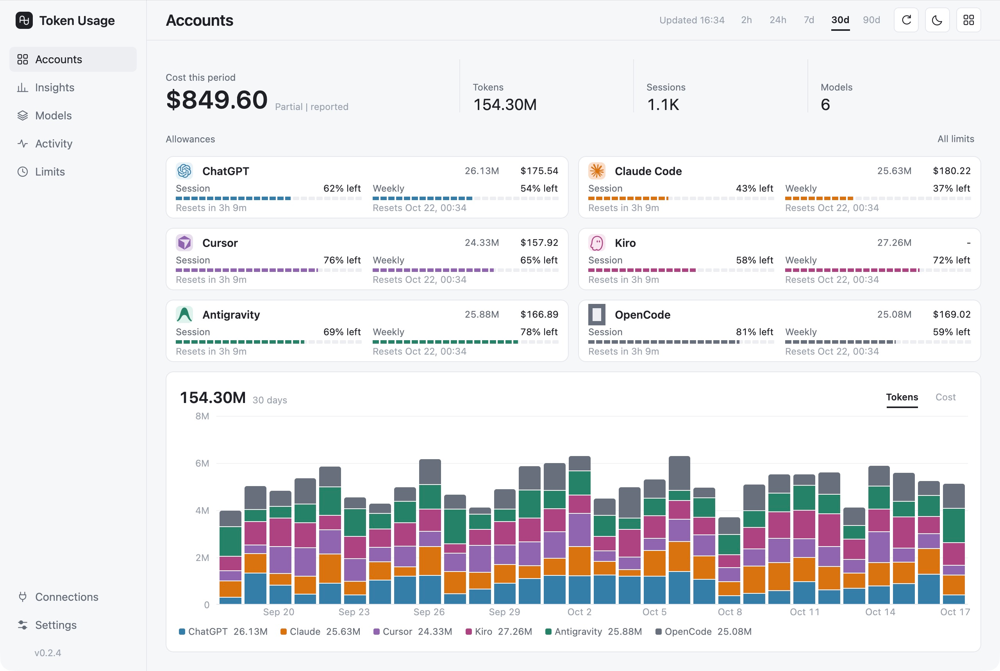
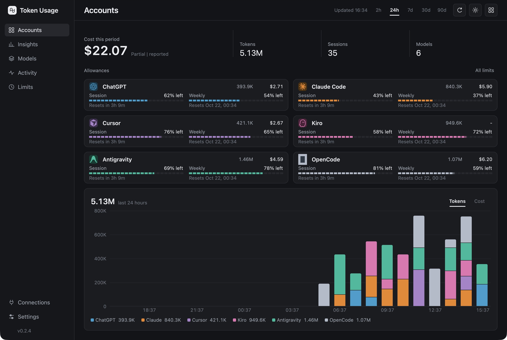

# Token Usage

Track AI usage, costs, and limits in one desktop app.

Supports **ChatGPT / Codex, Claude Code, Cursor, Kiro, Antigravity, and OpenCode**. Built with Rust and GPUI. Your history stays on your device.

[Download the latest release](https://github.com/ChiragVijay/token-usage/releases/latest)



## Install

| Platform | Download | Setup |
| --- | --- | --- |
| Windows x64 | `token-usage-X.Y.Z.exe` | Run the installer. No administrator access required. |
| macOS 13+ · Apple Silicon | `token-usage-X.Y.Z.dmg` | Open the disk image and drag **Token Usage.app** into **Applications**. |

Mac builds are not notarized. If macOS blocks the download or app, open **System Settings → Privacy & Security → Open Anyway**, then confirm. Only do this for a download you trust. Intel Mac downloads are not available.

## Connect your tools

Sign in through your provider’s app or CLI, then open Token Usage. It detects existing logins and local history. Use **Connections** to add folders or import a Cursor CSV.

- See account limits, remaining allowances, and reset times.
- Explore token usage and costs by model, project, and time.
- Search activity, filter results, and export CSV.
- Switch between light and dark themes, hide figures with display privacy, or check usage from the tray.

Provider data varies. Kiro reports credits separately from tokens and dollars. OpenCode live account checks still need validation.



*Screenshots show sample data.*

## Privacy and costs

History and settings stay local. No telemetry; prompts and conversations are never uploaded. Existing credentials are used to check accounts, and provider stores are read-only.

Costs use provider-reported amounts when available, otherwise public API-rate estimates. Estimates exclude subscription fees and are **not your subscription bill**. Unknown prices display **-**.

Network requests check provider usage, fetch model prices, and check releases. Update checks run even when provider online refresh is off; app downloads start only after you choose **Update now**. Display privacy hides on-screen figures; CSV exports retain actual values.

## Build and CLI

Install Rust **1.97.1** (`mise install`), plus Xcode command-line tools on macOS or Visual Studio C++ Build Tools and a Windows SDK on Windows.

```sh
cargo run --release --bin token-usage
```

For a JSON usage report:

```sh
cargo run --release --no-default-features --bin usage -- --online --period 7d --json
```

Use `--offline --refresh` for local history and cached allowances. See `--help` for options.

[Development, updates, and release instructions](docs/DEVELOPMENT.md)

## Credits

Built with [GPUI](https://gpui.rs/) and [gpui-component](https://github.com/longbridge/gpui-component). Integrations and design draw on [OpenUsage](https://github.com/robinebers/openusage), its [Windows fork](https://github.com/mesomya/openusage-windows), [ai-usagebar](https://github.com/akitaonrails/ai-usagebar), and [t3code](https://github.com/pingdotgg/t3code).

Provider icons come from OpenUsage and its Windows fork. Their [MIT notice](docs/licenses/OpenUsage-MIT.txt) and [Windows-fork notice](docs/licenses/OpenUsage-Windows-MIT.txt) ship with packaged builds.
